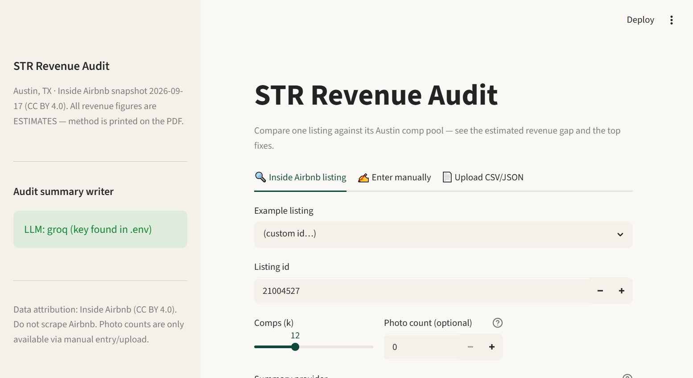
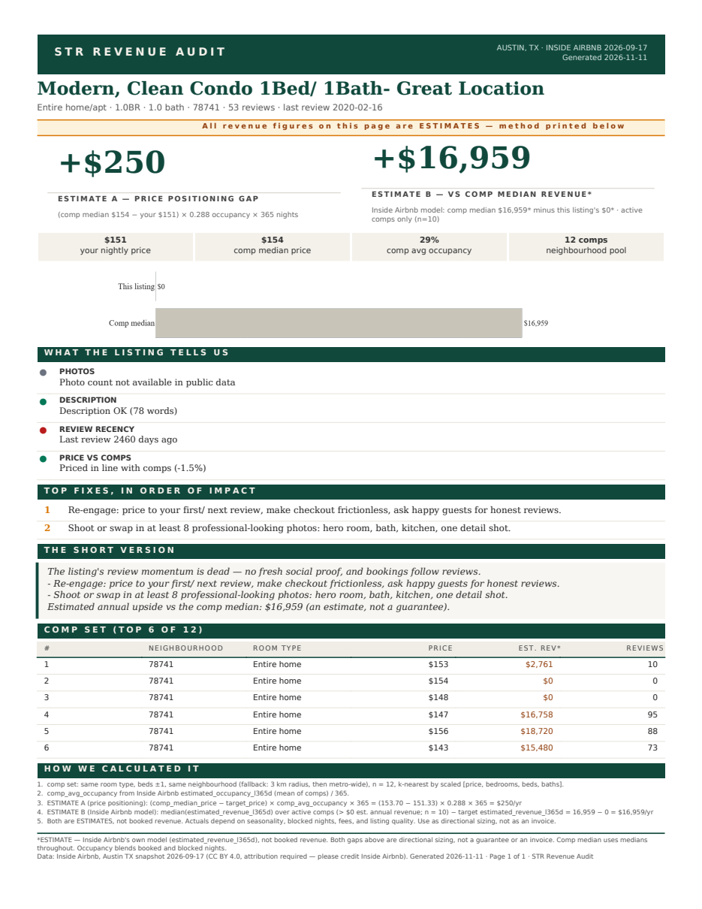

# STR Listing Revenue Audit

Take one short-term rental listing in a metro, compare it to local listings from
[Inside Airbnb](https://insideairbnb.com/) (free, public, CC BY 4.0), and produce
a one-page PDF showing the estimated revenue gap and the top fixes.
Audience: non-technical property managers. **The PDF is the product.**

Every revenue number in the report is labelled **ESTIMATE** with the calculation shown.

## What it looks like

| Streamlit app | PDF one-pager |
|---|---|
|  |  |

Sample output (anonymized — listing identity, exact location and photos removed; based on a real underperforming Austin listing):
**[docs/sample_audit.pdf](docs/sample_audit.pdf)**
— a dead Austin 1BR condo, $0 modelled annual revenue vs a $16,959 comp-median estimate.
The tool's job: show a property manager the gap and the top fixes, honestly labelled as estimates.

## Status

- [x] Phase 0 — Research & reuse plan (approved 2026-11-11)
- [x] Phase 1 — Pipeline: load one metro, build a comps table for a single listing
- [x] Phase 2 — Audit signals + revenue-gap estimate + LLM summary (Gemini/Groq free tier, offline fallback)
- [x] Phase 3 — One-page PDF (xhtml2pdf) + Streamlit app (look up / enter / upload a listing, download PDF)
- [x] Phase 4 — STR Owner Lead Finder: host-level lead scoring → audits on weakest listings → LLM pitch drafts → review queue + CSV export (see below)

## Data source & attribution

Inside Airbnb, "Austin, Texas, United States" snapshot dated **2026-09-17**,
licensed CC BY 4.0. If you use this project's outputs, credit **Inside Airbnb**
as the source (CC BY 4.0 requires it). No Airbnb scraping is performed or permitted here.

We download three files (see `scripts/download_data.py`):

| File | Size | Used for |
|---|---|---|
| `listings.csv.gz` | ~6.8 MB | listing facts: price, room type, beds, reviews, location |
| `calendar.csv.gz` | ~9.5 MB | availability/price over next ~12 months |
| `reviews.csv.gz` | ~61 MB | review recency & volume signals (Phase 2) |

## Setup

```bash
python -m venv .venv && .venv\Scripts\activate   # Windows
pip install -r requirements.txt
python scripts/download_data.py                    # fetches Austin 2026-09-17 into data/
```

## Phase 1 — comps table for one listing

```bash
# comps for a specific listing id, written to outputs/
python -m str_audit.comps --listing-id 12345678 --k 12

# deterministic demo on a sample listing
python -m str_audit.comps --demo
```

`str_audit.comps` prints the table to stdout and writes `outputs/comps.csv`.

## Phase 2 — audit + revenue gap + summary

```bash
python -m str_audit.audit --listing-id 21004527   # full audit, prints report + writes outputs/audit_<id>.json
```

Signals (all our own logic, thresholds in `str_audit/signals.py`):
weak photos (user-entered count only; public data has none → reported `unknown`),
thin description (<60 words), review recency (stale after 180 days; 0 reviews = fail),
price vs comp median (>10% off = flag).

Both revenue numbers — **always labeled ESTIMATES with formulas printed**, and the headline
is now a **conservative range** (A → B), never a single figure:
- **A, price positioning:** `(comp_median_price − target_price) × comp_avg_occupancy × 365`
- **B, Inside Airbnb model:** `median(comp estimated_revenue_l365d, active comps only) − target's`
- If comps are too thin (**n < 8**) or too dissimilar (stdev/median of comp prices **> 0.6**), the
  report and the pitch drafts say **INSUFFICIENT DATA** and quote nothing.

### LLM summary (optional — works without keys)

The summary runs through Gemini or Groq free tier, selected at runtime:

```bash
cp .env.example .env      # Windows: copy .env.example .env
# edit .env: GEMINI_API_KEY=...  or  GROQ_API_KEY=...  and LLM_PROVIDER=gemini|groq
python -m str_audit.audit --listing-id 21004527 --provider gemini
```

With no keys (or `--provider none`), a deterministic fallback summary is produced
from the audit dict — no invented numbers, works offline. Prompt lives in
`str_audit/audit_prompt.py`; every call is wrapped so any API failure degrades
to the fallback instead of crashing.

## STR Owner Lead Finder (Phase 4)

From the same Inside Airbnb Austin snapshot, find the hosts who likely need a property
manager, audit their weakest listing, draft a personalized outreach email, and queue
it for **your** review. There is **no send button anywhere** — output is an approval
queue and a CSV you send from your own mailbox.

Flow: `score → audit weakest listing → draft pitch → review → approve → export CSV`

```bash
python scripts/score_leads.py                # Phase 1: score all hosts (upserts into data/leads.db)
python scripts/score_leads.py --audit 10     # Phase 2: audit weakest listing of top 10
python scripts/score_leads.py --pitch 10     # Phase 3: draft pitches for those 10
streamlit run leadfinder_app.py              # Phase 4: review queue → approve/reject → CSV export
```

- **Lead score** (`str_leads/score.py`, custom, v2.0, max 16): transparent weighted points,
  tuned toward small self-managing owners (roughly 1–4 listings) with weak listings —
  stale/missing reviews (+3), price ≥10% below the neighbourhood median (+3), thin description
  (+2), bottom-tercile modelled revenue (+2), portfolio of 2 (+2, plus +1 for the 3–4 sweet
  spot, capped at 5+), not a superhost (+1). Reasons are stored per lead and shown in the UI.
  Likely agencies (calculated metro-wide listings ≥ 5 — configurable with `--agency-cutoff`,
  or company-like name tokens) are excluded; `--include-agencies` overrides.
  **Note:** re-scoring does not happen silently — run `python scripts/score_leads.py` yourself
  to refresh the DB (it upserts scores only; statuses/contacts/notes are preserved).
- **Audits** (`str_leads/audit_bridge.py`): reuses `str_audit.audit.run_audit` untouched on each
  lead's weakest listing; the audit JSON path + ESTIMATE gaps are linked from the leads DB.
- **Pitches** (`str_leads/pitch.py`, custom): the LLM only fills the body from an allow-listed
  brief of audit facts; the subject is deterministic; the sender block and opt-out line are
  appended in code and verified by `can_spam_ok()`. Figures quoted are always the audit's
  ESTIMATE figures, labeled as such. Offline deterministic fallback when no LLM key.
- **Store** (`str_leads/store.py`): SQLite (`data/leads.db`, gitignored). `host_id` is the
  dedupe key; re-running the scorer refreshes scores, never your statuses/notes/contacts.
  Status flow: `new → approved | rejected → sent → replied → meeting`, plus
  `no_contact` and `do_not_contact`.
- **Contact discovery is manual and public-info only**: the app captures the source URL of
  whatever you find (host website, business listing, county records). If no public contact
  exists, mark the lead `no contact` and move on. No guessing, no purchased lists.
  The **Contact research** panel records host website, source URL, `contact found` (yes /
  no / not found) and notes per lead, the sidebar shows the running found-rate, and the
  Export tab offers a **Leads needing contact research** CSV of unresearched, active leads.
- **CAN-SPAM**: drafts are flagged **not sendable** until `SENDER_NAME`, `SENDER_BUSINESS`
  and `SENDER_POSTAL_ADDRESS` are set in `.env` (every commercial email needs sender
  identity + a physical postal address + a working opt-out line — all are enforced by the
  review UI and flagged in the CSV export).
- **Hosted demo:** <https://str-lead-finder.onrender.com> — same app, but the instance runs
  with `LEADFINDER_REDACT_NAMES=1`: every host renders as initials (e.g. `S. N.`) in the
  queue, tables and both CSV exports, and the seeded DB contains only public Austin snapshot
  fields (regenerated by `scripts/build_lead_seed.py`). No real owner is identifiable from the
  demo. Local `streamlit run leadfinder_app.py` shows full names.

Snapshot note: the Austin 2026-09-17 file ships `host_since` and `host_response_rate` as
100% NULL (Inside Airbnb removed them) — those two weights never fire on this data.

## Deploy

**Live:** app — <https://str-revenue-audit.onrender.com> · landing page — <https://str-revenue-audit-site.onrender.com>
(free Render tier; auto-deploy from `main`). Steps for other hosts: **[docs/deploy.md](docs/deploy.md)**.

## Phase 3 — one-page PDF + Streamlit app

```bash
# generate the PDF from the CLI (no Streamlit needed)
python -m str_audit.report --listing-id 21004527
#   -> outputs/audit_21004527.pdf

# run the app (upload / enter / look up a listing, download the PDF)
streamlit run app.py
```

The app has three entry points: **Inside Airbnb listing** (by id, e.g. the curated
`21004527`), **Enter manually** (feeds the photo-count signal — public data has none),
and **Upload CSV/JSON** (same fields as the manual form; sample template downloadable in-app).

### What's on the page (and why a PM reads it)

- **Verdict headline** — the conservative ESTIMATE range (price-positioning gap A → Inside Airbnb model gap B), or an explicit **INSUFFICIENT DATA** callout when the comp set is too thin/dissimilar. Never a bare number.
- **Listing Health Score** — 0–100 composite of the four signals with the deduction formula printed (e.g. `70 — Solid but leaky; −25 review recency, −5 photos (unknown)`).
- **Two ESTIMATE cards** (formulas printed) + comp occupancy / median / count chips + a P25/median/P75 price chart vs this listing.
- **Signals → ranked fixes**, an LLM-written summary in plain English, the comps table, and the full calculation method in fine print.

### Branding / white-label
Set **`CLIENT_BRAND`** in the environment (Render → service → Environment, or locally) to stamp your client's brand on the masthead:

    CLIENT_BRAND="Acme Property Group" python -m str_audit.report --listing-id 21004527

Masthead becomes "ACME PROPERTY GROUP · POWERED BY STR REVENUE AUDIT" — your client's name on every page you hand over, our method credit in the footer. To rename the product default itself: `templates/audit_report.html` (`.wordmark`), `app.py`, `.streamlit/config.toml`. Palette: deep green `#0d3b31`, bone `#f4f1ea`, amber `#d97706`.

### PDF engine note
WeasyPrint (Phase 0 pick) needs GTK/Pango system libraries this Windows machine lacks —
no winget/package manager available either. **xhtml2pdf** (pre-approved fallback, Apache-2.0)
is used instead; the Jinja2 template is table-based CSS written to port back to WeasyPrint
on Linux/macOS unchanged. See `CREDITS.md`.

## File map (every file, and why it exists)

| File | Why it exists |
|---|---|
| `README.md` | This file: what/why/how, data attribution, commands. |
| `CREDITS.md` | Rule 2 compliance: every reused repo/lib, its license, what we took. |
| `.gitignore` | Keeps `.env` secrets, `data/`, and `outputs/` out of git. |
| `.env.example` | Template for Phase 2 LLM keys (Gemini/Groq). Real values live in `.env`, never committed. |
| `requirements.txt` | Minimal pinned-ish deps. Phase 1: pandas, duckdb, scikit-learn. |
| `scripts/download_data.py` | Fetches the Austin 2026-09-17 Inside Airbnb files into `data/` (idempotent, stdlib only). |
| `app.py` | Streamlit app — three ways in (look up / enter / upload), audit view, PDF download button. |
| `templates/audit_report.html` | The one-page PDF: Jinja2 + table CSS (xhtml2pdf-safe). All ESTIMATE labels, method and attribution render from data; branding is here (`.band-title`). |
| `str_audit/report.py` | Audit dict → styled HTML → PDF bytes. Owns the Plotly→kaleido chart (PNG base64; silently omitted if kaleido can't run) and the Jinja view model. |
| `assets/fonts/` | DejaVu TTFs embedded in the PDF (Bitstream Vera license — see `assets/fonts/README.txt`). |
| `.streamlit/config.toml` | App theme: deep green primary, warm off-white background, no usage stats. |
| `requirements-dev.txt` | Dev tools only: pytest, pypdf, pypdfium2. |
| `str_audit/__init__.py` | Package marker + version. |
| `str_audit/data.py` | Loads `listings.csv.gz`, normalises the messy fields (`$1,234` → float, `bathrooms_text` → number, t/f → bool). All Inside Airbnb weirdness is handled here, once. |
| `str_audit/comps.py` | Builds the comps table for one listing: same room type, bed-band, neighbourhood (falls back to radius), then k-nearest on scaled [price, beds, bedrooms, baths]. |
| `str_audit/signals.py` | Our audit logic: photo/description/review-recency/price-vs-comps signals with thresholds as named constants; ranks top fixes by severity. |
| `str_audit/revenue.py` | The two ESTIMATE figures (price-positioning gap; Inside Airbnb model gap over active comps) with formulas and caveats returned alongside. |
| `str_audit/audit_prompt.py` | The audit-summary prompt — ours. Non-technical tone, no invented numbers, ESTIMATE language baked in. |
| `str_audit/llm.py` | Thin Gemini/Groq wrapper (free tiers, keys from `.env`). Any failure degrades to a deterministic plain-text fallback built from the same audit dict. |
| `str_audit/audit.py` | Phase 2 orchestrator: listing → comps → signals → estimate → summary; prints the report and writes `outputs/audit_<id>.json`. (Phase 3 renders the same dict to PDF.) |
| `tests/` | pytest smoke tests on synthetic data — no network. `python -m pytest tests/ -v` |
| `outputs/` | Generated artefacts (gitignored). |
| `scripts/score_leads.py` | Lead-finder pipeline driver (Phases 1–3): score → upsert → audit top-N → draft pitches. Read-only over the snapshot; writes `data/leads.db`. |
| `leadfinder_app.py` | Streamlit review queue (Phase 4): pick a lead → read audit → edit draft → approve/reject/track → CSV export. No send path. |
| `str_leads/data.py` | Host-level aggregation from the raw snapshot via DuckDB (host_id … host_url), joined onto `str_audit.data.load_listings` facts. Project 1 loader untouched. |
| `str_leads/score.py` | The custom lead score (rule 7): weighted points + human-readable reasons, agency exclusion, v1.0. |
| `str_leads/audit_bridge.py` | Audits each lead's weakest listing via `str_audit.audit.run_audit` (untouched); writes `outputs/audit_<id>.json`; links it in `leads.db`. |
| `str_leads/pitch.py` | The custom pitch prompt + Jinja-free assembly: deterministic subject, LLM body (allow-listed brief), sender block + opt-out appended in code, `can_spam_ok()` gate. |
| `str_leads/store.py` | SQLite dedupe/status tracking (rule 7) — `host_id` PK; refresh-score-only upserts; CSV export. |
| `docs/phase0-lead-finder.md` | Phase 0 research: library options per category, licenses, contact-discovery limits. |

## License

This project's own code: MIT (see `CREDITS.md` for third-party licenses).
Data: Inside Airbnb, CC BY 4.0.
